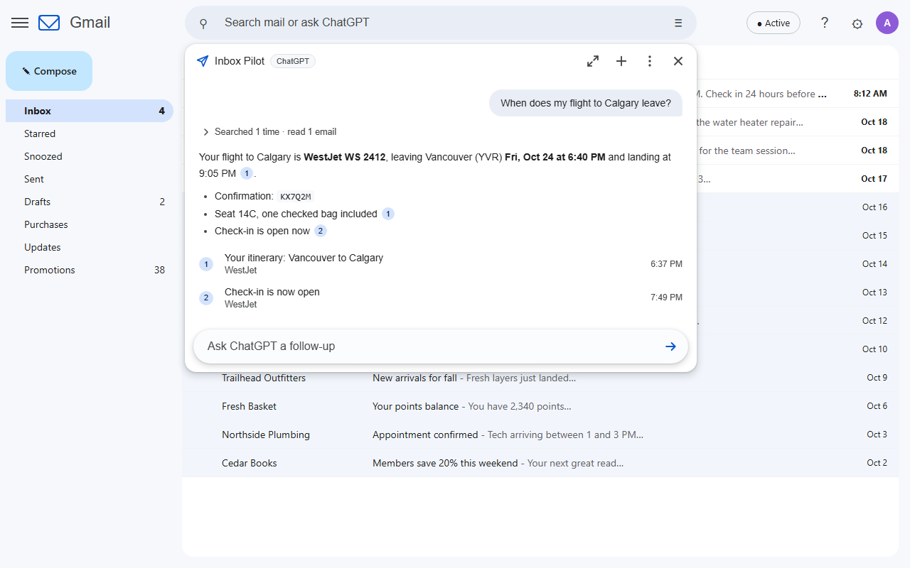

<p align="center"></p>

<h1 align="center">Inbox Pilot</h1>

<p align="center"><strong>Your ChatGPT, at the controls of your Gmail.</strong><br>
Ask questions from Gmail's search bar. ChatGPT finds the emails, reads the attachments, answers with links to its
sources, drafts replies, tidies your inbox and fills your calendar. On your own ChatGPT plan, with no server.</p>

<p align="center">
<a href="https://jd2005l.github.io/InboxPilot/">Website</a> ·
<a href="#install">Install</a> ·
<a href="PRIVACY.md">Privacy</a> ·
<a href="https://github.com/sponsors/JD2005L">Sponsor</a>
</p>



## What you can ask

- *When does my flight to Calgary leave, and what's the confirmation number?*
- *How much is the plumber's invoice and when is it due?* (reads the PDF itself)
- *Summarize this email and tell me what they need from me* (uses the email you have open)
- *Draft a reply saying Thursday works* (saves a draft; Inbox Pilot cannot send)
- *Archive the promotions older than two weeks* (shows you the list first, with Undo)
- *Put my flights for the Toronto trip in my calendar* (right time zones; you click Add)

Ordinary searches like `from:bob invoice` still search Gmail exactly as before. A chip at the end of the search bar
shows whether **Enter** will search or ask ChatGPT; click it to flip, or press **Shift+Enter** to always ask.

## Features

| | |
|---|---|
| **Find** | Questions become precise Gmail searches, retried and broadened until something answers them, with numbered links to the emails used. |
| **Read** | Whole conversations and their attachments: PDF, Word, Excel, PowerPoint, text, CSV and HTML. "This email" means the one you have open. |
| **Show** | "Pull it up" opens the email in Gmail; "show me everything from…" runs the search in Gmail's own list. |
| **Draft** | Replies threaded into the right conversation, or new emails, saved as drafts and opened for you to review and send. |
| **Organize** | Archive, mark read or unread, star, label, move to the inbox or Trash. Always a list you review and confirm, with Undo. Unsubscribe shows each sender's own unsubscribe link. |
| **Calendar** (optional) | Events from bookings and appointments, with times as the email states them (a flight departs in one time zone and lands in another), the details you need on the day, and a link back to the email. You click **Add** on each. Also answers "am I free Thursday afternoon?". |
| **Looks like Gmail** | The answer drops down under the search bar like Gmail's own suggestions, in Gmail's light or dark theme. Expand it for long conversations; **Esc** closes it. |

It is not Gmail's built-in "Ask Gmail" (Google's paid Gemini feature): Inbox Pilot uses your ChatGPT account and models.

## Install

**Chrome Web Store:** the listing is in review. Until it is live, install from source.

**From source:** you need Chrome 140 or later, Node.js 22.12 or later, and npm.

```bash
git clone https://github.com/JD2005L/InboxPilot.git
cd InboxPilot
npm ci
npm run build          # writes the extension to dist/
```

Open `chrome://extensions`, turn on **Developer mode**, click **Load unpacked** and choose the `dist` folder. The
settings page opens and starts the guided setup.

## Setup (about ten minutes, once)

You need a ChatGPT plan that includes Codex (Plus, Pro, Business, Edu or Enterprise) and a Gmail account. The
settings page walks through every click with direct links, checks each step, and shows the exact fix for every error
Google or OpenAI can show.

1. **Connect ChatGPT.** Click *Connect ChatGPT*, enter the short code on OpenAI's page, and approve *Codex*. If OpenAI
   says device code sign-in is off: ChatGPT, Settings, Security, *Enable device code sign-in for Codex*.
2. **Create your own Google app** (free, no credit card): a Google Cloud project with the Gmail API, the Google Auth
   Platform set up as *External* with yourself as a **test user**, and an OAuth client of type **Web application**
   with the redirect URI the settings page shows. Paste its Client ID into the settings page. Your own app means
   nobody else, including the author, ever has access to your mail.
3. **Connect Gmail.** Pick the account, click *Continue* on "Google hasn't verified this app" (it is your own app),
   and tick both Gmail boxes (the second allows drafts and organizing; leave it unticked for answers only).
4. **Ask.** Type a question into Gmail's search bar and press Enter.
5. **Calendar (optional).** Enable the Google Calendar API in the same project, then click *Connect Calendar* under
   Connections.

## Privacy and safety

- **No server.** The extension talks only to Google (your Gmail and Calendar) and OpenAI (your ChatGPT account).
  No analytics, and nothing is sent to the author.
- **Your Google app, your tokens.** Sign-in tokens stay in this browser's extension storage, out of reach of web
  pages and of the script that runs inside Gmail.
- **You approve every change.** Organizing and calendar events are proposals you confirm, each with Undo. There is
  no way to send email or delete anything permanently; Trash keeps mail for 30 days.
- **Email is data, not instructions.** ChatGPT is told never to follow instructions written inside an email, and a
  confirmed change can only touch exactly what its card showed. Email content is never rendered as HTML.
- **Conversations are not kept.** They live in the Gmail tab you asked in and disappear when it closes.

The full policy is in [PRIVACY.md](PRIVACY.md) (also published at
<https://jd2005l.github.io/InboxPilot/privacy.html>).

> **Note:** ChatGPT-plan access for third-party apps uses OpenAI's Codex sign-in, the same device-code flow as the
> open-source [Codex CLI](https://github.com/openai/codex). It works today, but OpenAI could change or restrict it.

## How it works

```
Gmail tab (content script: search-bar chip + answer panel, in a closed shadow root)
   │  long-lived port (ask, stop, apply, undo)
   ▼
Service worker
   ├─ ChatGPT: device-code sign-in → chatgpt.com/backend-api/codex/responses (streamed, store: false)
   │     tools: search_emails, read_thread, read_attachment, open_email, show_in_gmail, create_draft,
   │            propose_actions, and check_calendar / propose_event while Calendar is connected
   ├─ Gmail API, with a token from the user's own Google OAuth client (gmail.readonly, plus gmail.modify if granted)
   ├─ Calendar API, same token, if connected (calendar.events)
   └─ Offscreen document, only while reading a PDF: pdf.js text extraction
```

- **ChatGPT sign-in** is the Codex CLI's device-code flow (`codex login --device-auth`); the model list comes from
  the plan's own catalog.
- **Google sign-in** uses `chrome.identity.launchWebAuthFlow` with the user's OAuth client and renews silently every
  hour with exactly the scopes that were granted.
- **Changes are fenced in the background.** A Confirm can only touch the conversations its proposal showed
  (`ProposalBook`), and Add creates exactly the event its card showed (`EventBook`), each once. Every target is
  looked up first, so the model cannot invent one.

## Development

```bash
npm run check          # typecheck, lint, unit tests, build
npm run test:watch
npm run package        # store build and release/chrome-web-store-<version>/ (zip, listing text, images)
```

`npm run package` takes the store screenshots with the real built extension on a mock Gmail of made-up emails
(`store/mock-gmail.html`), with ChatGPT and the Gmail API replaced by scripted scenes (`store/stub.js`). It needs
Playwright's Chromium (`npx playwright install chromium`).

For your own build, you can put your Google client ID in `config/extension.config.json` (git-ignored; see the
`.example` file) or the `GMC_GOOGLE_CLIENT_ID` environment variable, and setup skips the paste step. Store builds
never include one. The unpacked build's extension ID is pinned by `config/extension-public-key.txt`
(`lkkohbhfochcaebnjenjjofieghkkkil`), so the Google redirect URI stays the same across rebuilds.

| Path | Role |
|---|---|
| `src/background/chatgpt/` | Device-code sign-in, token refresh (single-flight; refresh tokens rotate), streaming Responses client |
| `src/background/gmail/` | Google sign-in, Gmail API, message and MIME parsing, attachment text, draft builder |
| `src/background/calendar/` | Calendar API client, event validation (wall-clock times in IANA zones), the event fence |
| `src/background/chat/` | System prompt, tool definitions, the tool loop, organize and undo, the proposal fence |
| `src/offscreen/` | pdf.js text extraction, loaded only on demand |
| `src/content/` | Search-bar integration (Enter routing, chip), the answer panel, theme detection |
| `src/options/` | Settings page and setup guide |
| `src/shared/` | Messages, types, the DOM builder, the safe Markdown renderer |
| `scripts/` | Build, icon renderer, store packaging |
| `site/` | The project website (GitHub Pages) |

`CODEX_CLIENT_VERSION` in `scripts/build.mjs` is the Codex release the model catalog is requested for; bump it when
OpenAI ships models that need a newer client.

## Contributing and support

Bug reports, ideas and pull requests are welcome in [issues](https://github.com/JD2005L/InboxPilot/issues). Please
run `npm run check` before sending a change. For a setup problem, include your Chrome version and what the settings
page shows.

Inbox Pilot is free with nothing held back. If it saves you time, you can
[sponsor its upkeep](https://github.com/sponsors/JD2005L). Teams on Google Workspace can have it
[set up for them](https://jd2005l.github.io/InboxPilot/teams.html).

More by the author: [GitHub Actions Monitor](https://jd2005l.github.io/GithubActionsMonitor/) and
[GitHub Repo Navigator](https://jd2005l.github.io/GitHubRepoNavigator/).

## License and name

The code is licensed under the [GNU General Public License v3.0](LICENSE): you may use, study, change and share it,
and anything you distribute that is based on it must be released under the same license, with its source.

The license covers the code, not the name. "Inbox Pilot" and its paper-plane icon identify the official release by
James Levac; if you publish a fork (for example on the Chrome Web Store), give it a different name and icon so people
can tell them apart.

Not affiliated with or endorsed by Google or OpenAI. Gmail is a trademark of Google LLC; ChatGPT is a trademark of
OpenAI.
